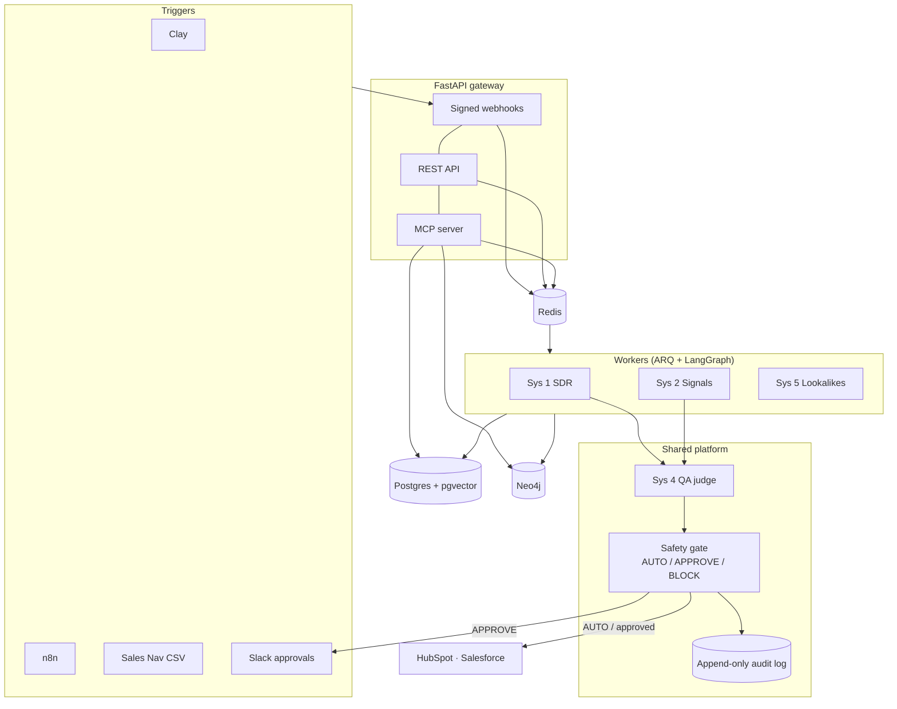

# GTM AI Platform

Five go-to-market automation systems on one shared Python platform: an autonomous SDR agent, a signal-to-meeting
engine, an MCP command center, an outbound QA layer, and a lookalike account finder. Everything outbound passes
through one human-in-the-loop safety gate, and everything runs offline against deterministic sandbox data.

**Status:** portfolio project. Runs end to end in sandbox mode with no API keys. It has not been used with real
customers or real outbound email (see [Limitations](#limitations)).

```bash
uv sync
uv run python scripts/demo_all.py    # all five systems, no keys, no Docker
uv run pytest                        # 142 tests (+1 that needs the Docker services)
```

## The five systems

| # | System | What it does |
|---|---|---|
| 1 | **Autonomous SDR** (`sys1_autonomous_sdr`) | A LangGraph agent turns a plain-English ICP ("Series B fintechs using AWS") into ranked accounts, drafts a personalised email per account, runs it through QA, pauses for human approval, sends, and logs to HubSpot and Salesforce. Approvals survive restarts (Postgres checkpointer). |
| 2 | **Signal-to-Meeting** (`sys2_signal_engine`) | Signed webhooks (n8n, Clay, Sales Navigator CSV) are de-duplicated, time-decayed and combined into an intent score. Crossing 75 triggers a draft that cites every contributing signal. |
| 3 | **Command Center** (`sys3_command_center_mcp`) | An MCP server with 10 typed tools (search, enrich, lookalikes, signals, campaigns, approvals, a GDPR purge) plus a voice/NL layer that asks for confirmation before any write. Works from Claude Desktop or any MCP client. |
| 4 | **Outbound QA** (`sys4_outbound_qa`) | Scores every email for hallucination, tone and relevance before it can be sent, and attributes reply rates to prompt versions. |
| 5 | **Lookalike Finder** (`sys5_lookalike_finder`) | Ranks accounts by tech/investor overlap, industry, champion paths and embedding similarity, with an explainable score breakdown. Postgres is synced into a Neo4j graph. |

## Architecture



## Design decisions

**Three-tier safety policy.** Every outbound action is classified by one deterministic function (`gtm_safety/policy_engine.py`)
evaluated in a fixed order, `BLOCK` then `APPROVE` then `AUTO`, so a hard stop can never be downgraded by a later rule.

| Tier | When |
|---|---|
| `BLOCK` | unsubscribed or bounced contact, suppression-list match, any hallucination, composite QA below 0.75, missing unsubscribe footer, rate cap hit, contacted in the last 14 days |
| `APPROVE` | any `tier_1` account, sandbox mode, or `GTM_REQUIRE_APPROVAL_ALL=true`; pauses the graph with `interrupt()` and posts to Slack |
| `AUTO` | everything else (only reachable in production with live sending enabled) |

*Account tier* (`tier_1..3`, ICP quality) and *safety tier* (`auto|approve|block`, what we do about it) are deliberately separate concepts.
The gate re-checks at send time, because an approval can wait 48 hours while a contact unsubscribes. A replayed approval ID
is rejected so an old link can never approve a different email.

**Signal scoring.** Each signal has a base strength (champion moved 85, funding 80–90, hiring spike 55 + 2.5 per open role capped at 80, ...)
that halves every 14 days: `strength × 0.5^(age/14)`. Signals on one account combine with a noisy-OR,
`100 × (1 − Π(1 − sᵢ/100))`, so independent signals reinforce each other but never exceed 100. Consumed signals can't re-trigger.

**QA with a rule-based floor.** The judge asks an LLM to score hallucination, tone and relevance
(`composite = 0.5·h + 0.25·t + 0.25·r`; pass requires `h == 1.0` and `composite ≥ 0.85`). Independently, a deterministic checker verifies that
every number, funding stage, technology, investor, title and recipient name in the draft exists in the source facts. The lower score wins,
so a lenient or confused model cannot let a fabricated claim through, and an LLM outage falls back to the rules rather than failing open.
When run against a real model, the first draft invented a "30%" statistic; the checker flagged it, the agent rewrote the email, and the second draft passed.

**Sandbox first.** Every external client (Apollo, Clay, HubSpot, Salesforce, Slack) implements a mock that returns deterministic fixtures
when its key is `mock`. Fixture domains use the reserved `.example` TLD so a sandbox email can never reach a real inbox.

## Running it

**No services needed** (in-memory store, fake Redis):

```bash
uv run python scripts/demo_all.py
GTM_REPO=memory uv run uvicorn apps.api_gateway.main:app --port 8000   # Windows: use `make api`
```

**Full stack** (Postgres 16 + pgvector, Redis, Neo4j):

```bash
cp .env.example .env            # if 5432 is taken locally, set PG_PORT=55432 and match DATABASE_URL
docker compose up -d postgres redis neo4j
uv run alembic upgrade head
uv run python scripts/apply_neo4j.py
uv run python scripts/seed_sandbox_data.py      # 200 accounts, 600 contacts, 120 signals
docker compose up -d api worker                 # or: make api / make worker
uv run pytest                                   # integration tests now run too
```

**Real models.** Anthropic works out of the box; any OpenAI-compatible endpoint works too:

```bash
ANTHROPIC_API_KEY=...                                   # default provider
LLM_PROVIDER=openai_compat LLM_BASE_URL=https://integrate.api.nvidia.com/v1 LLM_API_KEY=... \
  LLM_PRIMARY_MODEL=<model> LLM_JUDGE_MODEL=<model> LLM_DISABLE_THINKING=true   # for reasoning models
```

Without a key, the parser, drafter and judge use deterministic implementations, so nothing depends on a model being up.

**MCP.** `uv run python -m sys3_command_center_mcp.server` (stdio), then point Claude Desktop or any MCP client at it.

## Repository layout

```
packages/   gtm_core (config, models, repo, embeddings, llm) · gtm_integrations (clients + mocks) · gtm_safety (policy, gate, compliance)
systems/    sys1..sys5 (one package each)         apps/   api_gateway, worker (ARQ)
migrations/ Alembic (9 tables, append-only audit log)    infra/terraform/   ECS Fargate (ARM64), RDS, ElastiCache, SSM, OIDC deploy role
tests/      unit · integration · evals (50-email golden QA set)    .github/workflows/   ci.yml, cd-ecs.yml
```

## Testing

| What | How it is checked |
|---|---|
| Logic and APIs | 142 unit/integration tests (in-memory store; no Docker) |
| Database paths | Alembic migration, Postgres repo, Neo4j sync and the full HTTP flow were run against real Postgres/Redis/Neo4j and in Docker containers |
| QA judge | 50-email golden set: 15/15 planted hallucinations blocked, 25/25 clean pass, 10/10 spam fail |
| Types and style | `mypy` and `ruff` clean (also run in CI) |
| Infra | `terraform validate` passes (AWS provider 5.x) |

## Limitations

- **No real outbound email.** No sending provider is wired; live mode fails loudly instead of silently dropping mail. Sandbox logs sends.
- **Synthetic data only.** The golden QA set is templated, so 100% shows rule coverage, not real-world recall. The rule-based checker catches specific wrong facts, not vague uncited claims ("typically see reduced waste within weeks").
- **Lookalike quality is unproven.** On the randomly generated sandbox data the ranker performs at chance (precision@10 of 0.00 against 0.10 for random). It needs real customer data to evaluate.
- **Third-party integrations are exercised against mocks and rejected-credential responses**, not against live accounts (Apollo, HubSpot, Salesforce, Slack).
- **Not deployed.** The Terraform and GitHub workflows validate/parse but have not been applied.
- Sales Navigator has no public API; signals arrive through Clay or CSV export only. LinkedIn is never scraped.

## License

MIT
